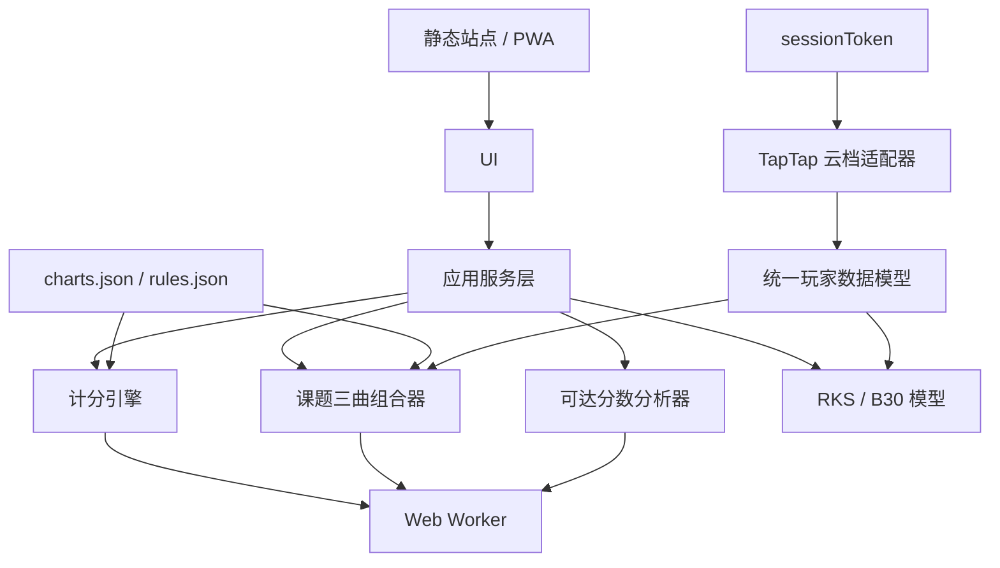

# 02 — 纯静态技术架构

## 总体结论
第一版不需要 PhiTarget 自有服务器。站点只托管静态 HTML/CSS/JS/JSON；所有计算在浏览器运行；玩家通过 sessionToken 从 PhiHub 的 TapTap 云档接口读取成绩，成绩只保留在当前页面内存。用户主动选择本机保存账号时，token 才会写入浏览器 localStorage。

## 推荐技术栈
TypeScript + Vite；React（若已有仓库则沿用）；Web Worker；Vitest；Playwright（可选）；PWA 离线能力作为后续增强。

## 模块边界
```text
src/
  pages/ target-score/ challenge-combinations/ reachable-scores/ player-profile/ settings/
  components/ chart-card/ score-breakdown/ badge-selector/ plan-card/ filter-panel/ score-bucket-chart/
  core/ scoring/ normal-solver/ challenge-solver/ reachable-scores/ challenge-combinations/ personal-model/ rks/
  data/ schemas/ loaders/ versions/
  adapters/ phigros-cloud/
  workers/
  tests/
```
`core` 不依赖 React、DOM 或浏览器 API。UI 不得复制计分公式；所有计算通过 core service 完成。

## 架构图


## 云档读取边界
`src/core/phigrosCloud.ts` 负责调用 `https://phib19.top:8080/get/cloud/saves`，把 PhiHub/phi-plugin 使用的 `saveInfo` 与 `gameRecord` 映射成 PhiTarget 的成绩模型。浏览器直接请求该接口，接口需要返回 CORS 许可；PhiTarget 不做代理、不把 token 写入后端、IndexedDB、URL 或日志。用户主动保存账号时，当前浏览器 localStorage 只保存账号名称、服务器和 token。刷新页面后，未保存的账号需要重新连接。

云档只提供最高分、ACC、FC 等摘要时，规划器不能推断完整的 P/G/B/M 和谱面顺序；界面应把这些结果标为个人成绩参考，而不是实际胜率。localStorage 不保存云档成绩快照。

## 性能策略
- 单曲公式计算直接在主线程。
- 三曲组合搜索与可达分数枚举放入 Web Worker。
- 先按难度、曲包、难度范围筛选，再组合搜索。
- 使用排序+双指针、哈希或 meet-in-the-middle；避免保存所有三重组合。
- 只返回不同策略的 Top-K/Pareto 方案。
- 支持取消任务、进度反馈和结果缓存。

当前实现：课题三曲组合和可达分数分析通过 `src/workers/calculation.worker.ts` 在后台线程计算；主页面只保留筛选、渲染和目标附近查询，避免大物量谱面或全曲库组合搜索阻塞输入。

## 后端边界
只有接口取消 CORS、需要一次性导入链接、OAuth、受控 API 代理、机器人推送或跨设备同步时，才考虑 Serverless Worker。Worker 不得成为核心计算依赖，不得成为开放代理，不记录 sessionToken/API Token。
