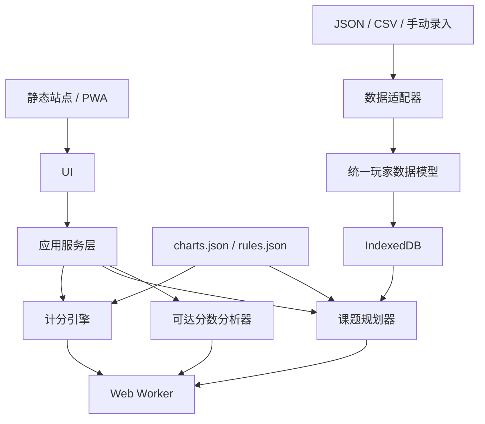

# 02 — 纯静态技术架构

## 总体结论
第一版不需要服务器。站点只托管静态 HTML/CSS/JS/JSON；所有计算在浏览器运行；玩家成绩导入后写入 IndexedDB。

## 推荐技术栈
TypeScript + Vite；React（若已有仓库则沿用）；IndexedDB（原生或 Dexie）；Web Worker；Vitest；Playwright（可选）；PWA 离线能力作为后续增强。

## 模块边界
```text
src/
  pages/ target-score/ challenge-planner/ rescue/ reachable-scores/ player-profile/ settings/
  components/ chart-card/ score-breakdown/ badge-selector/ plan-card/ filter-panel/ score-bucket-chart/
  core/ scoring/ normal-solver/ challenge-solver/ reachable-scores/ challenge-combinations/ personal-model/
  data/ schemas/ loaders/ versions/
  adapters/ manual/ json/ csv/ phi-plugin/
  storage/ indexed-db/ migrations/
  workers/
  tests/
```
`core` 不依赖 React、DOM 或浏览器 API。UI 不得复制计分公式；所有计算通过 core service 完成。

## 架构图


## 本地数据
IndexedDB stores：`profiles`、`chartRecords`、`scoreHistory`、`savedPlans`、`preferences`、`importMetadata`。提供本地导出、删除和备份。不要把完整成绩历史放入 localStorage。

## 性能策略
- 单曲公式计算直接在主线程。
- 三曲组合搜索与可达分数枚举放入 Web Worker。
- 先按难度、曲包、难度范围筛选，再组合搜索。
- 使用排序+双指针、哈希或 meet-in-the-middle；避免保存所有三重组合。
- 只返回不同策略的 Top-K/Pareto 方案。
- 支持取消任务、进度反馈和结果缓存。

## 后端边界
只有需要一次性导入链接、OAuth、受控 API 代理、机器人推送或跨设备同步时，才考虑 Serverless Worker。Worker 不得成为核心计算依赖，不得成为开放代理，不记录 sessionToken/API Token。
